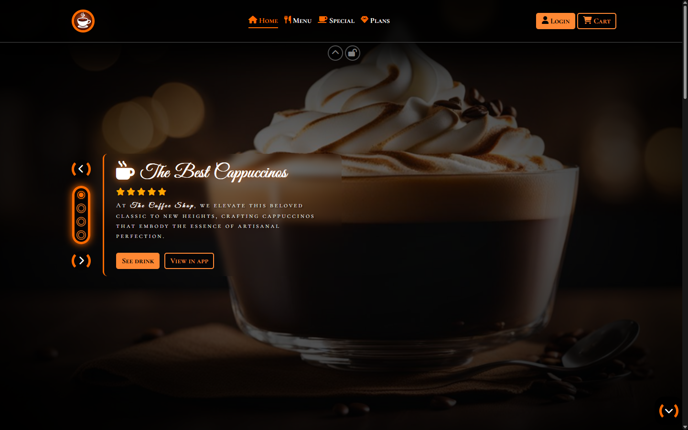
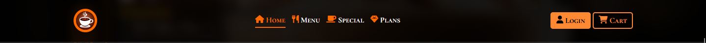
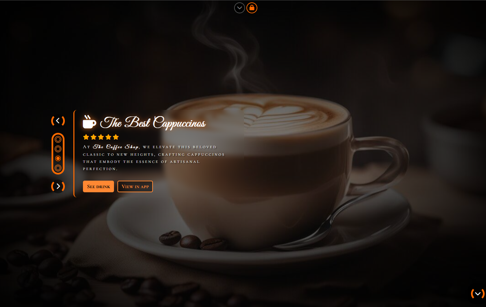
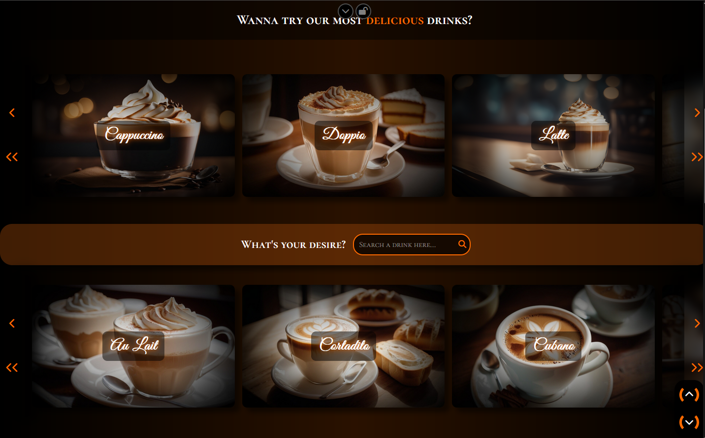
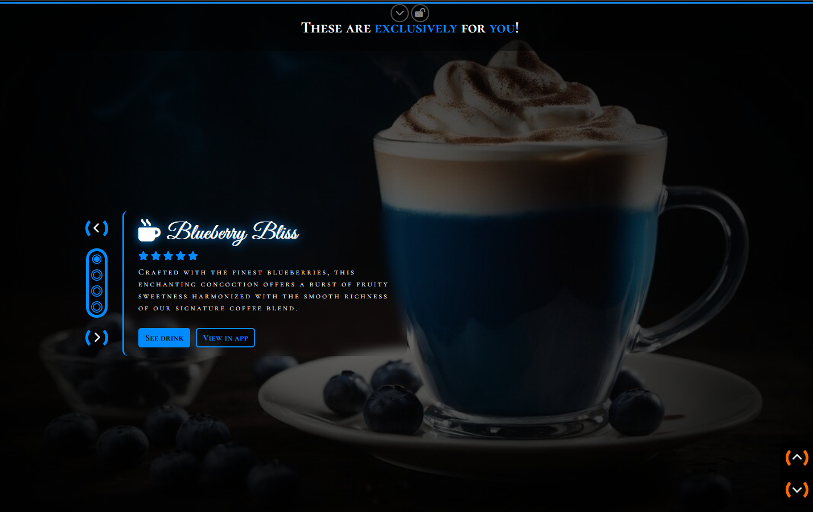
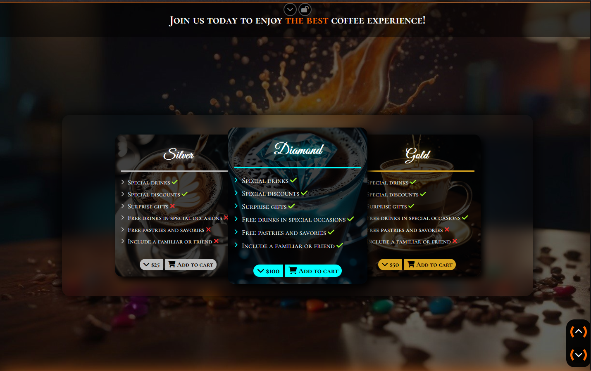
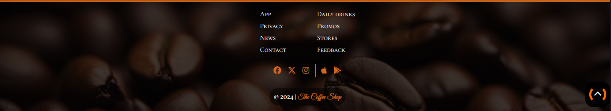

<p align="center">
    
    <h1 align="center">Sip Station</h1>
    <p align="center"><strong>Artisanal Coffee & Handcrafted Brews Web Platform</strong></p>
</p>

Welcome to **Sip Station**! A responsive, aesthetically rich, and modern web application crafted for coffee lovers and artisanal cafe experiences. Built entirely with Vanilla HTML5, CSS3, and modular ES6+ JavaScript, Sip Station combines fluid micro-animations, glassmorphism aesthetics, accessible keyboard navigation, and comprehensive multi-channel contact features.

---

## 📸 Preview



---

## ✨ Key Features

### ☕ 1. Header & Smart Navigation
- **Glassmorphic Aesthetic:** Frosted translucent background with blur filters (`backdrop-filter`) and smooth border highlights.
- **Brand Title Micro-Animation:** Interactive rotating and expanding brand animation on hover for **Sip Station**.
- **Dynamic Scroll-Spy:** Real-time active section tracking that highlights the current navigation anchor (`Home`, `Menu`, `Special`, `Plans`, `Contact`) as you scroll.
- **Menu State Lock Toggle:** Dedicated control button allowing users to lock/unlock navbar visibility.
- **Auto-Hide on Scroll:** Navbar auto-collapses on scroll down to maximize content view and expands on scroll up.
- **Accessible Mobile Hamburger Menu:** Fully accessible off-canvas drawer with `inert` focus trapping and ESC-key support.



### 🌟 2. Hero Showcase
- **Fullscreen Beverage Slider:** High-resolution drink presentations with smooth auto-play and manual carousel navigation.
- **Rating & Notes:** Client satisfaction star ratings and artisanal roast profiles.
- **Interactive Triggers:** Modal view button and mobile app integration buttons.



### 📋 3. Menu & Infinite Draggable Carousels
- **Dual Carousels:** Infinite looping coffee cards categorized by drink specialties.
- **Mouse & Touch Gestures:** Smooth grab-and-drag functionality on desktop and swipe on mobile devices.
- **Card Peeking Effect:** Overflowing cards partially peek to hint at additional carousel items.
- **Live Search & Autocomplete:** Quick search bar to filter coffee beverages and launch details modals.



### 🔮 4. Special Blends Section
- **Dynamic Theme Synchronization:** Section background color dynamically adapts to match each specialty drink slide.
- **Sticky Element Tinting:** Floating and sticky elements seamlessly adopt the active drink's color palette.



### 💎 5. Membership Plans
- **Tiered Memberships:** Silver, Gold, and Diamond tiers with benefit comparisons and perks.
- **Interactive Pricing Switcher:** Live toggle between monthly and yearly billing rates.
- **Card Animations:** Elevated hover states with glowing accents.



### 📬 6. Dedicated Contact & Alternative Details
- **Multi-Channel Contact Directory:** Quick-access cards featuring both primary and alternative communication channels.
- **Alternative Contact Methods:**
  - **Phone & Hotline:** Primary Order Line, Alternative Support Line, WhatsApp/SMS Concierge, and Toll-Free.
  - **Email Inboxes:** General Inquiries, Alternative Customer Care, Event Catering, and Wholesale Partnerships.
  - **Stations & Pickups:** Flagship Roastery, Alternative Uptown Hub, and Alternative Metro Kiosk.
  - **Schedule:** Weekday, Weekend, and Alternative Holiday hours.
- **Interactive Contact Form:** Built-in preferred contact method selector (Email, Phone, WhatsApp), categorized inquiry types, and animated confirmation feedback.

### 👣 7. Enhanced Footer
- **Comprehensive 4-Column Directory:** Brand mission, quick navigation links, direct & alternative contact details, and station timings.
- **Social Media Hub:** Links to Facebook, X (Twitter), Instagram, Apple App Store, and Google Play Store.
- **Copyright:** Official Sip Station branding notice.



---

## 📞 Contact & Alternative Detail Directory

For quick reference, here are the primary and alternative contact details for **Sip Station**:

| Channel | Primary Detail | Alternative Detail | Availability |
| :--- | :--- | :--- | :--- |
| **Phone** | `+1 (555) 747-7828` *(Orders)* | `+1 (555) 747-7829` *(Support)*<br>`+1 (555) 747-8326` *(WhatsApp)*<br>`1 (800) 555-SIPS` *(Toll-Free)* | Mon–Sun: 6:00 AM – 10:00 PM EST |
| **Email** | `hello@sipstation.com` *(General)* | `support@sipstation.com` *(Customer Care)*<br>`events@sipstation.com` *(Catering)*<br>`partners@sipstation.com` *(Wholesale)* | 2-Hour Response Guaranteed |
| **Locations** | `104 Coffee Blvd, Suite 100`<br>Seattle, WA 98101 *(Flagship)* | `742 Evergreen Ave`, Seattle, WA 98109 *(Uptown Hub)*<br>`452 Metro Concourse B`, Seattle, WA 98104 *(Express Kiosk)* | Dine-in, Curbside, Drive-thru |
| **Operating Hours** | Mon – Fri: 6:00 AM – 9:00 PM<br>Sat – Sun: 7:00 AM – 10:00 PM | Holidays: 7:00 AM – 6:00 PM<br>Mobile Ordering: 24/7 via App | Roasting daily from 5:00 AM |

---

## ♿ Accessibility Features

Sip Station is built with accessibility (a11y) at its core:
- **Semantic HTML5:** Proper heading hierarchies (`h1` through `h4`), `<nav>`, `<main>`, `<section>`, and `<footer>` elements.
- **Screen Reader Support:** Full ARIA landmarks, `aria-label`, `aria-controls`, `aria-expanded`, and `aria-current` attributes.
- **Focus Management:** Active `inert` attribute management on hidden menus to ensure keyboard focus remains contained.
- **Keyboard Navigable:** Smooth tab indexing across all interactive elements, modal dialogs, and navigation controls.

---

## 🛠️ Technology Stack

- **Markup:** HTML5 (Semantic & Accessible)
- **Styling:** Vanilla CSS3
  - Custom Properties / CSS Variables (`--clr-neutral-*`, `--bg-dark-*`, etc.)
  - Fluid typography & spacing using CSS `clamp()`
  - Glassmorphic backdrop filters and smooth CSS transitions
- **Scripting:** Modern ES6+ JavaScript (Modular Architecture)
- **Icons:** FontAwesome 6 (Free)
- **Typography:** Google Fonts (*Cormorant SC*, *Great Vibes*, *Open Sans*)

---

## 📁 Project Structure

```plaintext
Sip Station/
├── assets/
│   ├── imgs/                   # Images (slides, cards, backgrounds, logos, previews)
│   └── misc/
│       └── fontawesome-free-*/ # FontAwesome icon library
├── CSS/
│   ├── 404/                    # 404 page specific styles
│   ├── global/
│   │   ├── boilerplate.css     # CSS reset and base rules
│   │   ├── custom-props.css    # Color tokens, themes, typography variables
│   │   ├── fonts.css           # Webfont declarations
│   │   └── typography.css      # Base typography
│   ├── sections/
│   │   ├── contact.css         # Contact cards, form, and alternative detail styles
│   │   ├── controls.css        # Floating scroll-to-top/bottom controls
│   │   ├── footer.css          # Multi-column footer layout & contact directory
│   │   ├── header.css          # Fixed glassmorphic navigation header
│   │   ├── hero.css            # Hero carousel & slide controls
│   │   ├── menu.css            # Infinite menu card carousels & modal search
│   │   ├── plans.css           # Membership plan cards & pricing switcher
│   │   └── special-drinks.css  # Specialty slides with dynamic color shifting
│   └── utils/
│       ├── buttons.css         # Button variants and hover effects
│       └── misc.css            # Utility classes and wrappers
├── JS/
│   ├── app.js                  # Main entry point & event orchestrator
│   └── modules/
│       ├── cardCarousel.js     # Drag-and-scroll infinite menu carousel logic
│       ├── controls.js         # Scroll navigation and indicator buttons
│       ├── navbar.js           # Scroll-spy, lock toggle, hamburger drawer
│       ├── slidesCarousel.js   # Hero and special drinks autoplay sliders
│       └── utils.js            # Shared DOM utility helpers
├── 404.html                    # Custom 404 error page
├── index.html                  # Main application landing page
└── README.md                   # Project documentation
```

---

## 🚀 How to Run Locally

Because the project uses standard ES6 JavaScript modules (`import`/`export`), it is best served via a local web server:

### Option 1: VS Code Live Server
1. Open the project folder in VS Code.
2. Install the **Live Server** extension if not already installed.
3. Right-click on `index.html` and select **"Open with Live Server"**.

### Option 2: Node.js (npx serve)
```bash
npx serve .
```
Navigate to `http://localhost:3000` (or the port displayed in your terminal).

### Option 3: Python Built-in Server
```bash
# Python 3
python -m http.server 8000
```
Open `http://localhost:8000` in your browser.

---

## 📄 License & Credits

- **Brand:** Sip Station
- **Design & Architecture:** Developed with modern front-end best practices and accessible design patterns.
- **Icons:** [FontAwesome Free](https://fontawesome.com/)
- **Photography:** Royalty-free assets for coffee shop demonstrations.
